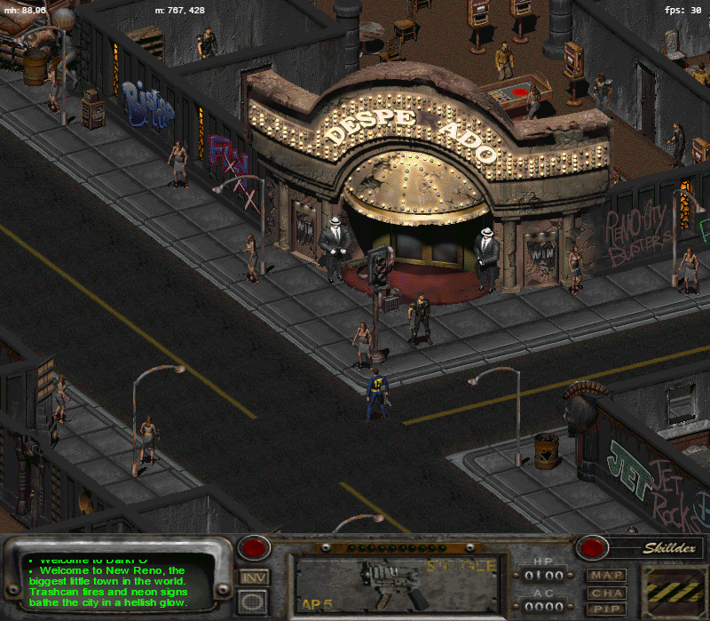

# DarkHarold2

A post-nuclear RPG remake

This is a modern reimplementation of the engine of the video game [Fallout 2](http://en.wikipedia.org/wiki/Fallout_2), as well as a personal research project into the feasibility of doing such.

The project is based on [darkfo](https://github.com/darkf/darkfo) codebase, but is modernized for Python 3, potentially
with more improvements and bug fixes coming in the future.

It is written primarily in TypeScript and Python, and targets recent browsers with WebGL 2.0 support.

## Status

DarkHarold2 is not a complete remake at this time. Estimated overall completion: **~99%**.
Every gap tracked in [`wiki/known_bugs.md`](wiki/known_bugs.md) before 2026-10-24 was closed on the `100percent` branch, including
the systems previously deferred: movies, talking heads and speech, radiation, drugs and addiction, party level-ups,
the car, and line of fire. The 2026-10-18 audit re-checked every wiki doc against CE and the code and ported what
still differed (worldmap travel and random encounters, skill use, game-load script procs, translucency, …). The
remaining share is verification and a few documented approximations: there has been
no full end-to-end playthrough yet, and a handful of places still simplify CE (listed under "Known approximations"
below). The 2026-10-24 function-by-function CE parity audit
([`wiki/CE_PARITY_AUDIT.md`](wiki/CE_PARITY_AUDIT.md)) found 1780 CE function rows, 835 of them matching, and opened
23 HIGH groups (known_bugs §33) plus ~150 MED findings; all 23 HIGH groups were fixed the same day (script opcodes,
character rules, combat, the map pipeline, doors, worldmap, dialogue, VM robustness, music), and on 2026-10-25 119 of the
120 MED findings (known_bugs §34 lists what is left). See [`ROADMAP.md`](ROADMAP.md) and [`wiki/known_bugs.md`](wiki/known_bugs.md) for the canonical trackers.

If you're looking for documentation on how Fallout 2 works, documentation on certain file formats, or
tools to work with them, this project will be useful to you as well.



---

## Project Index / New Contributor Readthrough Guide

If you're new to the codebase, read these files in the order below. The list mirrors how
existing maintainers stay oriented; each section builds on the previous.

### 🗺️ Start here

| File | Purpose |
|---|---|
| [`README.md`](README.md) | This file — project overview, completion status, build commands |
| [`CLAUDE.md`](CLAUDE.md) | AI-assistant instructions, research workflow, architecture rules, what NOT to implement |
| [`ROADMAP.md`](ROADMAP.md) | Phased plan toward 95%; canonical completion estimate |

### 📐 Architecture & codebase

| File / dir | Purpose |
|---|---|
| [`CODEBASE.md`](CODEBASE.md) | Full module map, repository layout, file responsibilities, key data flows |
| `src/` | TypeScript engine (renderer, object, critter, vm, scripting, combat, party, …) |
| `src/main.ts` | Main game loop, input handling, map-load entry |
| `src/heart.ts` | 60 Hz heartbeat loop |
| `src/globalState.ts` | Central game-state singleton (`gMap`, `player`, `combatActive`, …) |
| `src/config.ts` | Engine / UI / scripting / combat flags |
| `shaders/` | GLSL shaders (vertex, fragment, lighting, font) |
| `lut/` | Pre-baked JSON lookup tables (LST indexes, crit tables, palette data) |

### 📚 Wiki (read in this order)

Pre-audited summaries of CE behaviour with DH2 gaps already identified. Trust these over raw CE source reads.

| Order | File | Topic |
|---|---|---|
| 1 | [`wiki/README.md`](wiki/README.md) | Wiki index and lookup-order rules |
| 2 | [`wiki/CODEBASE_FOCE.md`](wiki/CODEBASE_FOCE.md) / [`wiki/CODEBASE_jsFO.md`](wiki/CODEBASE_jsFO.md) | Reference-source orientation |
| 3 | [`wiki/CROSS_CHECK_NOTES.md`](wiki/CROSS_CHECK_NOTES.md) | Where DH2 disagrees with CE/jsFO and why |
| 4 | [`wiki/known_bugs.md`](wiki/known_bugs.md) | **Canonical bug/feature tracker** — S/C/P/U/FA/RD/LE/IW/CI categories with fix status |
| 5 | [`wiki/animation.md`](wiki/animation.md) | FRM format, atlas system, `artOffset` zero-jump model, FA-series known gaps |
| 6 | [`wiki/failed_animation_offset_attempts.md`](wiki/failed_animation_offset_attempts.md) | Full post-mortem of pixel-drift fix attempts (Attempts 0–7) |
| 7 | [`wiki/rendering.md`](wiki/rendering.md) | WebGL pipeline, z-sort, lighting passes, accepted deviations |
| 8 | [`wiki/combat.md`](wiki/combat.md) | Combat loop, hit/damage formulas, crit tables, AI turns |
| 9 | [`wiki/weapon_combat.md`](wiki/weapon_combat.md) | Weapon AP costs, burst spread, called shots, reload |
| 10 | [`wiki/damage_formula.md`](wiki/damage_formula.md) | Per-step damage math (RD → DT → DR → CM → final) |
| 11 | [`wiki/ai_behavior.md`](wiki/ai_behavior.md) | AI packets, distance modes, perception, taunts |
| 12 | [`wiki/scripting_vm.md`](wiki/scripting_vm.md) | VM architecture, three-file split (`vm.ts`/`vm_bridge.ts`/`scripting.ts`) |
| 13 | [`wiki/scripting_reference.md`](wiki/scripting_reference.md) | Opcode reference and coverage table |
| 14 | [`wiki/dialogue_system.md`](wiki/dialogue_system.md) | Dialogue runtime, MSG files, `gsay`/`giq` chain |
| 15 | [`wiki/worldmap.md`](wiki/worldmap.md) | Worldmap travel, encounter tables, area entrances |
| 16 | [`wiki/car_system.md`](wiki/car_system.md) | Highwayman car system deep-dive: CE-vs-DH2 tables, bytecode-extracted per-map parking tiles, gap list |
| 17 | [`wiki/map_scripting.md`](wiki/map_scripting.md) | Map-level script hooks (`map_enter_p_proc`, etc.) |
| 18 | [`wiki/items.md`](wiki/items.md) | Item system, weights, stacking rules |
| 19 | [`wiki/proto_system.md`](wiki/proto_system.md) | Proto binary layout (types 0–5) and JSON schema |
| 20 | [`wiki/file_formats.md`](wiki/file_formats.md) | DAT2/FRM/PRO/MSG binary layouts |
| 21 | [`wiki/character_stats.md`](wiki/character_stats.md) / [`wiki/critter_stats.md`](wiki/critter_stats.md) | SPECIAL stats, derived stats, base ranges |
| 22 | [`wiki/perks_traits.md`](wiki/perks_traits.md) | Perk and trait registries, effects |
| 23 | [`wiki/skill_checks.md`](wiki/skill_checks.md) | Skill-use rolls, modifiers, XP awards |
| 24 | [`wiki/companion_party.md`](wiki/companion_party.md) | Party system, CHA cap, follow logic |
| 25 | [`wiki/quest_system.md`](wiki/quest_system.md) | Quest GVAR tracking, Pip-Boy ARCHIVES |
| 26 | [`wiki/pipboy.md`](wiki/pipboy.md) | Pip-Boy panels, AUTOMAP, clock/alarm |
| 27 | [`wiki/interface_windows.md`](wiki/interface_windows.md) | HUD, character/inventory windows, indicator bar |
| 28 | [`wiki/hotkeys.md`](wiki/hotkeys.md) | Default keybindings |
| 29 | [`wiki/save_load.md`](wiki/save_load.md) | Save/load format, IndexedDB slots, thumbnails |
| 30 | [`wiki/time_clock.md`](wiki/time_clock.md) | In-game time, day/night cycle, midnight queue |
| 31 | [`wiki/spatial_triggers.md`](wiki/spatial_triggers.md) | Spatial trigger system |
| 32 | [`wiki/tile_system.md`](wiki/tile_system.md) | Tile grid, hex math, screen projection |
| 33 | [`wiki/pathfinding.md`](wiki/pathfinding.md) | A\* path-blocking vs shoot-blocking, MULTIHEX |
| 34 | [`wiki/lighting.md`](wiki/lighting.md) | Lightmap, ambient curve, object light emission |
| 35 | [`wiki/sound_system.md`](wiki/sound_system.md) | Audio engine, GainNode chain, ambient SFX |
| 36 | [`wiki/economy.md`](wiki/economy.md) | Caps, barter formula, vendor stock |
| 37 | [`wiki/faction_reputation.md`](wiki/faction_reputation.md) | Karma, town reputation, title tiers |
| 38 | [`wiki/status_effects.md`](wiki/status_effects.md) | Poison, radiation, addictions, drug effects |
| 39 | [`wiki/random_numbers.md`](wiki/random_numbers.md) | PRNG seeding, `rollSkillCheck` ranges |
| 40 | [`wiki/settings.md`](wiki/settings.md) | Config/preferences system |
| 41 | [`wiki/actions.md`](wiki/actions.md) | `actions.cc` dispatch, death animations, float text |
| 42 | [`wiki/endgame.md`](wiki/endgame.md) | Endgame slides, death narrator |
| 43 | [`wiki/extended_flags.md`](wiki/extended_flags.md) | Wall/scenery `extendedFlags` orientation bits — egg occlusion vs light blocking |
| 44 | [`wiki/alignment.md`](wiki/alignment.md) | Screen-space anchor reference for all renderable categories (floor/roof `−96`, object bottom-centre anchor, `uniformFrameWidth` vs `frameWidth`, `8.4` lightmap-UV inverse) **plus the lighting-alignment work** — centring offset (RD17 §6), interpolation stripes / `hex-lerp` (§7), W-E wall occlusion (LD11 §8), object light-sampling modes (`wall-clamp` default), alpha-silhouette wall top-fade, and moving-torch smoothing (`egg-split`); §9 lists all runtime `setLighting*/setObjectLighting*/setWallTopFade*/setPlayerLightSmooth` console commands |
| 45 | [`wiki/drugs.md`](wiki/drugs.md) | Drugs, chems, addiction and withdrawal (CE `item.cc` port) |
| 46 | [`wiki/palette_colors.md`](wiki/palette_colors.md) | Palette colour usage audit — palette vs hard-coded colours |
| 47 | [`wiki/scroll_clamping.md`](wiki/scroll_clamping.md) | Map scroll borders and edge rendering (`tileSetBorder`, `tileSetCenter`) |
| 48 | [`wiki/ts-split-refactor.md`](wiki/ts-split-refactor.md) | Source split strategy and the subfolder / barrel convention |
| 49 | [`wiki/lua_scripts.md`](wiki/lua_scripts.md) | Scripts decompiled to Lua (`tools/int2lua.py`), the Lua backend and the VM-vs-Lua test |
| 50 | [`wiki/lua_variable_names.md`](wiki/lua_variable_names.md) | Review list for the decompiled scripts' variable names: inferred names and remaining numbers |
| 50a | [`wiki/CE_PARITY_AUDIT.md`](wiki/CE_PARITY_AUDIT.md) | 2026-10-24 function-by-function CE parity audit; per-subsystem tables in `wiki/ce_audit/` |
| 51 | [`wiki/upu_support.md`](wiki/upu_support.md) | The Unofficial Patch (UPU) and mod folders: what UPU changes, how DH2 builds and loads it (`mods/<name>/`, sfall functions, global scripts, hooks), conflicts |
| 52 | [`wiki/edit_history.md`](wiki/edit_history.md) | Sprint notes, newest first |
| 53 | [`wiki/autocrawler.md`](wiki/autocrawler.md) | AutoCrawler: automated map / dialogue / combat test harness, URL auto-start, report format |

### 🐛 Known issues & roadmap

| File | Purpose |
|---|---|
| [`wiki/known_bugs.md`](wiki/known_bugs.md) | Primary tracker — fix status per ID across all subsystems |
| [`ROADMAP.md`](ROADMAP.md) | Phased plan (Phases 1–9) toward 95% with audit dates |
| Inline `// TODO` / `// FIXME` in `src/` | Source-level annotations |
| [`CLAUDE.md`](CLAUDE.md) → "Intentionally Incomplete Systems" | Remaining deliberate approximations |

### 🔧 Asset pipeline (Python 3.9+)

All pipeline scripts live under [`tools/`](tools/) (moved from the repository root
2026-06-18 for a cleaner layout). `tools/setup.py` orchestrates the full extraction; the
rest are reusable converters. Run everything from the **project root** (output paths
like `art/`, `proto/`, `maps/`, `lut/` are relative to your current directory, not to
the scripts' location):

```
pipenv run python tools/setup.py /path/to/Fallout2/installation/directory
```

Or use the graphical front-end — lets you pick which stages to run, whether to
overwrite already-generated output, and whether to delete the raw source files
(FRM/PRO/MAP/ACM) once converted (not needed for a real install, just for re-running
the pipeline):

```
pipenv run python tools/pipeline_gui.py
```

| File | Purpose |
|---|---|
| [`tools/setup.py`](tools/setup.py) | Full extraction pipeline — runs every other converter in order; `--stages`, `--skip-existing`, `--delete-originals` flags |
| [`tools/pipeline_gui.py`](tools/pipeline_gui.py) | Tkinter GUI front-end for `tools/setup.py` |
| [`tools/exportImagesPar.py`](tools/exportImagesPar.py) | FRM → PNG sprite exporter (parallel) |
| [`tools/frmpixels.py`](tools/frmpixels.py) | FRM pixel helpers and atlas generation |
| [`tools/exportPRO.py`](tools/exportPRO.py) / [`tools/proto.py`](tools/proto.py) | PRO binary → JSON |
| [`tools/fomap.py`](tools/fomap.py) | MAP → JSON (tiles, objects, spatials, lights) |
| [`tools/convertAudio.py`](tools/convertAudio.py) | ACM → WAV (`export_audio` stage; ACM decoded by `tools/acmDecoder.py`, a port of CE `sound_decoder.cc`) |
| [`tools/dat2.py`](tools/dat2.py) | DAT2 archive extractor |
| [`tools/pal.py`](tools/pal.py) | PAL palette loading |
| [`tools/fonts.py`](tools/fonts.py) | FON font extraction |
| [`tools/convertLST.py`](tools/convertLST.py) | LST → JSON pre-bake (`lut/lst/`) |
| [`tools/convertPRO.py`](tools/convertPRO.py) | Standalone PRO converter (debug) |
| [`tools/convertEndgame.py`](tools/convertEndgame.py) | Endgame slide extraction |
| [`tools/parseCritTable.py`](tools/parseCritTable.py) | EXE table extractor → `lut/` |
| [`tools/stitchWorldmap.py`](tools/stitchWorldmap.py) | World map tiles → `art/worldmap.png` (`stitch_worldmap` stage) |
| [`tools/mpserv.py`](tools/mpserv.py) | Multiplayer WebSocket server (unrelated to asset conversion) |
| [`tools/oldPy/`](tools/oldPy/) | Superseded/experimental script iterations, kept for reference only |
| [`wiki/animation.md`](wiki/animation.md) → "imageMap.json" | Atlas/imageMap.json schema reference |

---

## Feature completion

The buckets below are sourced from [`wiki/known_bugs.md`](wiki/known_bugs.md) (current
audit: 2026-10-25, the CE parity audit §33 / §34). Items marked FIXED there roll up here. If you spot a contradiction,
the wiki tracker is the source of truth.

### ✅ Substantially implemented (~85–100%)

- **Map loading & rendering** — tile maps, multi-elevation, WebGL 2.0 renderer, lightmap, real-time lighting, screen-space hex z-sort (RD09), camera clamp + `OBJECT_SCROLL_BLOCK` (RD11/RD12), per-building roof flood-fill + roofEgg transparency (RD06), post-roof hex cursor/outline pass (RD08), palette colour cycling for water/fire/monitors in both floor paths (RD10, `[system] color_cycling` / `cycle_speed_factor`), CE translucency for force fields, windows, steam and Stealth Boy (C57), pixel-precise `_tile_mask` hex picking (RD13), parity-correct lightmap hex sampling (RD17), directional wall light occlusion (LD11); see [`wiki/alignment.md`](wiki/alignment.md)
- **Walking & running** — the literal CE path finder (`pathfinderFindPath`, `canUseDoor`: NPCs open doors on the way, the player opens them himself — C45), separate shoot-blocking predicate (P6), `OBJECT_MULTIHEX` neighbour scan, scenery LoS via `OBJECT_LIGHT_THRU` (P7), exit grids (`set_exit_grids`, C39)
- **Combat** — `attackDetermineToHit` port (line-of-fire critter count, distance/perception with Long Range/Scope/Sharpshooter, min ST, Accurate, One Hander, knocked-down/multihex, combat difficulty — C18); `_compute_spray`/`_shoot_along_path` bursts that hit whoever stands on a line of fire, missed shots that fly on and hit someone else, grenade/rocket blast rings (C17); 6-level criticals, critical failures, YAAM, armor DR/DT, crippling, knockdown, DAM_DROP, fire; attack sound on frame 0 and damage on the FRM action frame (FA3); who-hit-me / retaliation and the reaction hit (C19); CE death animations (`_pick_death`: damage thresholds, violence level, Bloody Mess, fire dance, single-frame corpses) with their death sounds (C20); CE attack roll, critical failures, melee damage, difficulty, kill XP and AP rules after the 2026-10-17 audit (C22)
- **Combat AI** — CE `_combat_ai` port (C28):
  - Fights: target choice (`_ai_danger_source`), weapon switching and picking up weapons from the floor, called shots, primary/secondary hit modes with the friendly-fire check (`_ai_pick_hit_mode`, `_combat_safety_invalidate_weapon`).
  - Ammo and health: reloading and fetching ammo; stimpaks and chems by `chem_use`.
  - Movement: fleeing (`min_hp`, `hurt_too_much`, disengage past `max_dist`), distance preferences (charge, snipe, stay close), taunts (gated by the combat-taunts preference).
- **Perks & traits** — CE perk table (`perks/cePerks.ts`): perks addressed by CE id from scripts, per-rank stat effects (Toughness, Action Boy, Dodger, …), armor perks on equip (Powered Armor, …), `perkGetSkillModifier` as CE (K6); level-up with Swift Learner / Lifegiver, perk selection modal
- **Dialogue** — full `gsay_*`/`giq_option`/`gsay_option` set, barter/combat-control buttons, review log, highlight overlays; **talking heads** with fidgets, reactions and lip-synced speech (P4)
- **Bartering** — CE `_barter_compute_value`, reaction LVAR, Master Trader, difficulty bonus, scrollable tables, quantity picker
- **Party / companions** — `party_add`/`party_remove`, companion level-ups from `party.txt` (`_partyMemberIncLevels`), CE `_partyMemberSyncPosition` placement on map entry, script-driven following (`critter_p_proc`), companion control/customize/trade screens; the party travels with the player and is excluded from map snapshots (M10)
- **Inventory & items** — drag-and-drop, equip slots, carry weight, CE ammo stacks (C36), container capacity, CE ammo bar (AF5); script wield / unwield / strip as CE (C44); flares light, burn out and light their holder (C46); CE item menus and bags (open up to 9 deep) in the inventory, loot, steal and trade windows
- **Active skill use** — CE `skillUse` (C59): First Aid / Doctor / Repair with CE heal ranges, per-limb rolls by the party's best, robots only for Repair, time per attempt, the 3-a-day use slots (saved) and skill XP; Lockpick / Traps / Science left to the scripts as in CE; Sneak, Steal; party delegation (AC6)
- **Look & examine** — `look_at_p_proc`/`description_p_proc` scripts, CE health/crippled text, Awareness details, weapon/ammo lines (IU6)
- **Karma & reputation** — karma title, per-town reputation tiers; CE has no engine-side reaction modifier beyond the who-hit-me reaction hit (C19)
- **Worldmap** — CE travel loop (`wmPartyWalkingStep`, terrain pace, game time per frame) and random encounters (`wmRndEncounterOccurred` / `Pick` / `wmSetupRandomEncounter`: frequency, difficulty, Outdoorsman, formations, placement — C55), Pathfinder, walk masks, panning, labels; towns revealed by `mark_area_known` (W15), area state and party position saved; clicking the stopped party marker in the wilderness enters the desert map like CE (W16)
- **Car (Highwayman)** — script-driven like CE: town map scripts place the car, the trunk travels in the party (W14); speed tiers (blower / New Reno upgrade / super car), fuel-saving upgrades, out-of-gas handling, metarule 52/53 trunk capacity; see [`wiki/car_system.md`](wiki/car_system.md)
- **Scripting VM** — INT parser, all 181 vanilla opcodes bridged (S29), MVARs persisted per map (M8), `map_exit_p_proc` on every script (M9), timed events, `critter_p_proc` round-robin (CE `_script_chk_critters`)
- **Lua scripts (default)** — `tools/int2lua.py` decompiles 1440 of 1443 scripts to readable Lua (the other 3 are unused Fallout 1 leftovers), with global, map and local variables by name from the game data and Black Isle's sources (a few inferred and marked so; `data/scripts/variable_names.tsv` lists every variable and where its name comes from); they run by default (wasmoon; `[dh2] script_backend=vm` runs the `.int` bytecode instead, and an install without decompiled scripts falls back to it), `[dh2] mods=a,b` loads mod scripts in order. All 1436 decompiled scripts match the VM call for call in the `luadiff.html` test except one Black Isle script bug; the story crawler's deterministic playthrough of 29 main-quest maps (every dialogue path, every scripted object's examine / use / skill procedures, barter purchases, game time passing; 37 681 steps) is identical on both backends (L1–L18, [`wiki/lua_scripts.md`](wiki/lua_scripts.md))
- **Unofficial Patch (UPU), optional** — the pipeline builds the install's `mods/upu.dat` into a mod folder `mods/upu/` that the engine loads over the untouched vanilla files while `upu` is listed in `mods/mods_order.txt` (switch it off with a `;`); the sfall script functions, global scripts, hooks and virtual files UPU uses are ported (from CE where CE has them), all four of its global scripts run. Not yet played through on a real UPU install; the hi-res / `sfall.dat` art is left out (UP1–UP6, [`wiki/upu_support.md`](wiki/upu_support.md))
- **Time** — CE game clock and ambient light (`gAmbientIntensity`, Night Vision), midnight events, ARTIMER/AFAILED game events, time jumps drain timed events
- **Status effects** — radiation (`critterAdjustRadiation`/`processRads`), drugs and addiction from proto data with withdrawal perks, poison decay (S26)
- **Movies** — MVE → WebM pipeline stage, CE `gameMoviePlay` with subtitles and fades, Pip-Boy video archive (S15)
- **Audio** — music, weapon/action/ambient SFX, master/music/sfx/speech volumes, speech playback for talking heads
- **Pip-Boy** — CE STATUS page (quest locations from `quests.txt`, holodisk reader), ARCHIVES (video archive), AUTOMAP (CE's seen band, colours and High / Low detail; critters only with the Motion Sensor scanner), the CE alarm clock (`pipboyRest`: rest-location check, healing every 3 hours, until-party-healed), available after the Vault Suit movie (C40)
- **Character screen / HUD** — SPECIAL/skills/perks, warnbox indicator badges, numbers.frm counters, AP lights, end-turn lights with enable/disable (AF6), CE to-hit hover readout, CE action menu (use-on inventory, skill on target, push, rotate — C42)
- **Keyboard** — CE `gameHandleKey` layout: C I S O P Z N B M A Tab, 1–8 skills, Space / Return in combat, F1–F7 incl. quick save / load, Ctrl keys, brightness, rotate, date (C43)
- **Endings** — victory slideshow (CE pan timing), credits, death screen then back to the main menu (C41)
- **Save / load** — IndexedDB; player, party (+ levels), inventory + weapon ammo, GVARs, MVARs, area states, timed events, car state, kills, automap, skill use slots, seen movies, thumbnails; CE `gameReset` before NEW GAME and every load, so nothing leaks between games (U12); a load runs the map's start / map_enter / map_update procs with `is_loading_game` set, as CE (C61)
- **Preferences** — full CE options panel, persisted (localStorage) and seeded from `fallout2.cfg` (CI1); DH2-only options in a `[dh2]` section of the same file, e.g. `day_night_cycle=0` for CE lighting instead of the default smooth day/night curve (GTC10), `pixel_font=0` to use the browser font instead of the default Fallout pixel font on all UI text (U15), `script_fixes=0` to keep the original Black Isle script bugs the decompiled Lua repairs (L7), `elevator_use=0` to drop the Use action on elevators (a DH2 addition; CE elevators open only when you walk in, C66), `walk_model` / `anim_offset_model` to switch the CE walk and animation-offset models (FA13), `object_sort=ce|ce-dh2|dh2` for the object draw order (default `ce-dh2`: CE's tile order plus walls first on a shared tile; `dh2` = the old screen-space test, C67), `pipboy_available_at_game_start=1` (the sfall option; CE opens the Pip-Boy only after the Vault Suit movie, C40); `drag_windows=0` / `drag_<window>=0` to fix windows in place (dragging is a DH2 addition, C48); `debug_overlay=1` for the mouse-hex / tile / light / camera readouts (default off; console `setDebugOverlay(true)`), `fps_overlay=0` to hide the fps counter (default on; console `setFpsOverlay(false)`); `scroll_edge=<px>` for how close to the screen edge the map scrolls (default 10 — CE scrolls only on the edge itself); `scroll_limit=0` to let the screen centre scroll past the black map border (default 1: the border reaches the middle of the screen at most, RD19); `scroll_bounds=dh2` for the older scroll rectangle (default `ce`: CE's limits — the map's scroll-blocker ring and 480×400 px from the player, RD20), `scroll_player_limit=0` to drop that player limit (console `setScrollPlayerLimit(false)`), `walk_limit=0` to let the player and NPCs walk past the black border (default 1: they stop at it; exits outside it stay reachable); `mouse_mode=ce` for CE's clicks (a move click always walks, an arrow click does the primary action, holding the button opens the action menu; default `dh2`); `talk_mode=ce` to talk from where you stand when the critter is under 9 hexes away and in sight (CE; default `dh2` walks up first); `scroll_mode=ce` for CE's 32 × 24 px scroll steps at the edge and on the arrow keys (default `dh2`: smooth); `mouse_wheel=ce` to scroll the map with the wheel (default `zoom`); `save_slots=ce` for CE's ten save slots without DELETE (default `dh2`: unlimited); `egg_mode=dh2-egg|ce-egg|alpha|bbox` for the wall transparency around the player (default `dh2-egg`); `damage_formula=vanilla|glovz|glovz_tweak|yaam` for sfall's alternative damage formulas (default `vanilla`, wiki/damage_formula.md); the pipeline's `write_config` stage creates the file with CE defaults; combat looks/taunts, brightness (CE gamma table) are live (CI18)
- **Random numbers** — CE Park-Miller generator with MSVC seeding (RN)

---

### 🔶 Known approximations

- **Hover readout** is a DOM overlay rather than a cursor blit, and isn't shown for non-critter targets (CI18).
- **Action menu** opens on a command-mode left click instead of CE's held left button, and a move-cursor click uses what is under it (MOUSE-01 / 02); `[dh2] mouse_mode=ce` gives CE's clicks. The mouse wheel zooms instead of scrolling (C42 / C43; `[dh2] mouse_wheel=ce` scrolls). Map scrolling is smooth (`scroll_mode=ce`: CE's steps), Talk walks up to the critter first (`talk_mode=ce`: CE talks within 9 hexes in sight), and saves have unlimited slots (`save_slots=ce`: CE's ten).
- **Pip-Boy** — no idle screensaver (cosmetic).
- **Day / night** — DH2 adds a smooth day/night light curve by default; `[dh2] day_night_cycle=0` gives CE's script-only lighting (GTC10).
- **Skill use** — no black palette fade around First Aid / Doctor / Repair (cosmetic).
- **Browser limits** — preferences can't be written back to `fallout2.cfg` (CI5, localStorage instead); mouse sensitivity is stored but the browser owns pointer speed.
- **Script fixes** — the decompiled Lua repairs a Black Isle script bug where the sources make the intent clear (so far one: Redding's caravan guards are given their rifle as caps, L7); a deliberate deviation from the shipped scripts and CE, marked in the generated Lua, listed in [`wiki/lua_scripts.md`](wiki/lua_scripts.md) → "Script fixes", off with `[dh2] script_fixes=0`.
- **Not playthrough-verified** — systems were checked individually in the browser; a full main-quest run hasn't been done.

---

See [`wiki/known_bugs.md`](wiki/known_bugs.md) for the complete tracker with CE references and fix
status per ID.

---

## Roadmap

[`ROADMAP.md`](ROADMAP.md) is the canonical phased plan (Phases 1–9). The 2026-10-07 audit on the
`100percent` branch closes the remaining tracker items and the formerly deferred systems. Recent
work includes movies (S15), talking heads (P4), radiation, drugs and addiction, party level-ups, the
script-driven car (W14), line of fire and blast radius (C17), the `attackDetermineToHit` port (C18),
per-object weapon ammo (LE12), the CE perk table (K6), MVAR persistence (M8) and map-exit scripts (M9).
See the file header for the per-phase breakdown.

[`CLAUDE.md`](CLAUDE.md) → "Intentionally Incomplete Systems" now lists only the remaining
deliberate approximations.

---

## Data Pipeline

### Philosophy
The long-term goal is for the engine to own all its data in clean, typed, pre-baked JSON — no runtime parsing of original Fallout 2 file formats. Every conversion step that moves data out of `.lst`, `.pro`, `.ini`, or `.msg` files and into `lut/` is a step toward a fully self-contained engine that doesn't depend on the original file layout at runtime.

The existing `lut/` directory already follows this pattern:
- `lut/criticalTables.json` — crit tables extracted from the EXE
- elevator data — now compiled in from CE `elevator.cc` (`src/ceElevators.ts`), like the critical tables
- `lut/color_lut.json`, `lut/color_rgb.json` — palette data

LST files are next.

### LST → JSON pre-bake (`tools/convertLST.py`)
All Fallout 2 `.lst` files are converted to JSON arrays at setup time by `tools/convertLST.py` and written to `lut/lst/`. Each file is a plain JSON array indexed by line number, preserving exact indices.

**Naming convention:** consecutive duplicate path components are collapsed.

| Source | Output |
|---|---|
| `data/art/critters/critters.lst` | `lut/lst/art_critters.json` |
| `data/proto/critters/critters.lst` | `lut/lst/proto_critters.json` |
| `data/art/items/items.lst` | `lut/lst/art_items.json` |
| `data/art/scenery/scenery.lst` | `lut/lst/art_scenery.json` |
| `data/art/misc/misc.lst` | `lut/lst/art_misc.json` |
| `data/art/intrface/intrface.lst` | `lut/lst/art_intrface.json` |
| `data/scripts/scripts.lst` | `lut/lst/scripts.json` |

**Critical:** the converter splits on `'\n'` exactly — not `splitlines()` — to match the behaviour of `data.ts::loadLst()`. Any deviation will cause silent index drift in FRM resolution.

### Migration strategy
The runtime LST path (`data.ts::getLstId()`) is **not removed** — it stays intact as a fallback while call sites are migrated one at a time.

A parallel helper `getLstJson(lst, id)` reads from `lut/lst/` instead. Call sites in `pro.ts` are the primary migration target:

| Call site | LST | Status |
|---|---|---|
| `pro.ts::getCritterArtPath()` | `art/critters/critters` | 🔜 next |
| `pro.ts::lookupInterfaceArt()` | `art/intrface/intrface` | 🔜 next |
| `pro.ts::lookupArt()` | `art/items/items`, `art/scenery/scenery`, `art/misc/misc` | 🔜 next |
| `pro.ts::loadPRO()` | `proto/critters/critters` + 4 others | 🔜 next |
| `data.ts::lookupScriptName()` | `scripts/scripts` | later |

Skilldex and audio do **not** use LSTs and are not part of this migration.

When all call sites in a file are migrated, `getLstId()` calls in that file are removed. Once all files are migrated, `getLstId()` and `loadLst()` in `data.ts` are deleted.

## Installation

To use this, you'll need a few things:

-   A copy of Fallout 2 (already installed). You can buy one on [GOG](https://www.gog.com/en/game/fallout_2), download
    the standalone installer, and unpack on any platform supported by
    [innoextract](https://github.com/dscharrer/innoextract), or run the installer `.exe` if you're on Windows.

The other dependencies (on macOS with [Homebrew](https://brew.sh): `brew install pipenv innoextract node`):

-   Python 3.9 or later, earlier minor versions of Python 3 may work, but are not tested. Python 2 is not supported.

-   [Pipenv](https://github.com/pypa/pipenv) for Python dependency management.

-   The TypeScript compiler, installed via `npm install` (you'll need [node.js](https://nodejs.org/en/)).

-   [FFmpeg](https://ffmpeg.org/) for sound, movies and talking-head speech: on the PATH, or `ffmpeg.exe` placed in
    the project root (it is not part of the repository).

Once you've got all that, you can start trying it out.

Open a command prompt inside the DarkHarold2 directory, and then run:

```
pipenv install
pipenv shell
python tools/setup.py path/to/Fallout2/installation/directory
```

Or use the graphical front-end (`python tools/pipeline_gui.py`) to pick which stages to
run, whether to overwrite existing output, and whether to delete the raw source files
once converted. A Requirements panel shows whether numpy, Pillow, fontTools, FFmpeg and
node.js are there, and **Run** warns before it starts when a ticked stage needs one that
is missing (without numpy or Pillow it does not start; an option turns this check off).
Two progress bars show the whole run (stage i of n) and the running
stage (file i of n, with the file's name). Its output panel can show errors and warnings only, stage summaries, or
every file, collapses repeated lines, and copies or saves just what is shown — handy
for bug reports. **Cancel** stops a run and offers to remove the files it wrote
(git-tracked files are never touched).

This will take a few minutes, it's unpacking the game archives and converting relevant game data into a format DarkHarold2 can use.

You'll need an HTTP server to run (despite being all static content) due to the way browsers sandbox requests.
If you're comfortable with setting up nginx, lighttpd, or Apache, go for that. If not, a simple way is to use Python:

-   Python 3: `python -m http.server`

The pipeline's last stage, `compile_ts`, compiles the source code to `js/` (it runs
`npm install` first when `node_modules/` has no TypeScript yet, and needs node.js). After
changing `src/`, or without that stage, run `npm install` once and then `npx tsc`.

Browse to `http://localhost/play.html?artemple` (or whatever port you're using). If all went well, it should begin the game. If not, check the JavaScript console for errors.

Alternatively, Firefox can load directly from `file://` by opening `play.html` file.

Review `src/config.ts` for engine options. Be sure to re-compile if you change them.

Sound is converted by the pipeline's `export_audio` stage (default since 2026-10-23). Sound effects and music are decoded in Python (`tools/acmDecoder.py`, a port of CE's `sound_decoder.cc`) and need no external tool; speech (MP3) and movies need ffmpeg on the PATH or `ffmpeg.exe` in the project root.

## Debug Logging

All debug output is off by default and toggled at runtime via `Config.scripting.debugLogShowType`.
Flags are plain booleans on the global `Config` object — no rebuild needed.

### Enabling flags at runtime

Enable a single category in the browser DevTools console:

```js
Config.scripting.debugLogShowType.rolls = true
```

Enable multiple categories at once:

```js
Object.assign(Config.scripting.debugLogShowType, { combat: true, ai: true, damage: true })
```

### Flag reference

| Flag | Default | What it logs |
|------|---------|--------------|
| `stub` | `true` | Unimplemented script opcodes |
| `log` | `false` | `script log()` calls |
| `timer` | `false` | Timed event fire/cancel |
| `load` | `false` | Script file loads |
| `debugMessage` | `true` | `debug_message()` from scripts |
| `displayMessage` | `true` | `display_message()` (in-game console) |
| `floatMessage` | `false` | Floating critter messages |
| `gvars` | `false` | Global variable reads/writes |
| `lvars` | `false` | Local variable reads/writes |
| `mvars` | `false` | Map variable reads/writes |
| `tiles` | `true` | Tile/elevation changes |
| `animation` | `false` | Animation state transitions |
| `movement` | `false` | Pathfinding steps |
| `inventory` | `true` | Inventory add/remove |
| `party` | `false` | Party member status |
| `dialogue` | `false` | Dialogue node entry/exit |
| `combat` | `false` | Turn flow, enrollment, forceEnd |
| `ai` | `false` | AI packet lookup, action chosen, AP spent |
| `rolls` | `false` | Hit chance, roll result, hit/miss/crit |
| `skills` | `false` | Skill check rolls and outcomes (Lockpick, Doctor, Steal, …) |
| `damage` | `false` | Full damage formula: RD/CM/ADR/ADT/Base/Adj/Final |
| `script` | `false` | Script execution tracing (verbose) |
| `map` | `false` | Map load, exit grid, elevation |
| `object` | `false` | Object create/destroy/flags |
| `audio` | `false` | Audio load/play/stop |
| `renderer` | `false` | WebGL draw calls |
| `lighting` | `false` | Lightmap recalculation |
| `worldmap` | `false` | Worldmap travel and transitions |
| `encounters` | `false` | Random encounter rolls |
| `saveload` | `false` | Save/load slot operations |

### Example: auditing a combat encounter

1. Load `play.html?artemple`
2. In DevTools console:
   ```js
   Config.scripting.debugLogShowType.rolls = true
   Config.scripting.debugLogShowType.damage = true
   Config.scripting.debugLogShowType.ai = true
   ```
3. Trigger combat with a Giant Ant
4. Expected DevTools output:
   ```
   [ai]    [AI] Giant Ant turn start — AP: 10, packet: Giant Ant
   [ai]    [AI] Giant Ant → attack on you (AP cost: 4)
   [rolls] Giant Ant attacks you — hit chance: 45%
   [rolls] Giant Ant misses you. (roll: 67 vs target: 45)
   [damage] RD: 3 | CM: 2 | ADR: 30 | ADT: 4 | Base: 3 | Adj: 0 | Final: 0
   ```

Player-visible results (hits, damage, kills) still appear in the in-game console regardless of these flags.

## Combat Log

Every combat event (turn start/end, attack rolls, damage, AI decisions, kills) is appended to a structured in-memory log as `EventLogEntry` objects. The log persists across map changes and is saved with the save game, so you can review a full fight's history even after it ends.

### Exporting

Open the browser console during or after combat and call:

```js
exportEventLog()             // defaults to "full" tier
exportEventLog("summary")
exportEventLog("diagnostic")
```

This downloads a JSON file named `eventLog_<tier>_<timestamp>.json`.

You can also inspect the live log without downloading:

```js
__eventLog              // the full array
__eventLog.length       // number of entries recorded so far
```

### Tiers

| Tier         | Fields included                                                                 | Use case                          |
|--------------|---------------------------------------------------------------------------------|-----------------------------------|
| `summary`    | `round`, `turn`, `actor`, `action`, `result`, `damage` (only when > 0)         | Quick sanity check, who did what  |
| `full`       | All fields except `RD`, `DT`, `DR`, `CD`, `ammoX`, `ammoY`, `critMultiplier`, `critChance` | Normal debugging session |
| `diagnostic` | Every field, unfiltered                                                         | Chasing damage formula bugs       |

### Persistence

The event log is serialised into the save game. When a save is loaded, `globalState.eventLog` is restored from the file, so the full fight history is available even after a page reload. Saves written before the `eventLog` field was introduced are loaded cleanly (the log starts empty).

## FAQ

**Note**: This section has been copied from `README.md` of DarkFO, the answers don't represent opinions of the current maintainer
of DarkHarold2 and are only given to explain the status quo. The technical direction of DarkHarold2 may change in the future.

-   **Q:** Why TypeScript? Why a browser?

    A: Everyone has a browser: it's a portable platform for running code with more features than people expect.
    There are other projects that use native code already... and are already seeing segfaults. :)

    The project started out in JavaScript and was ported to TypeScript as it was continuing to grow. TypeScript strikes
    an excellent balance between useful and safe.

-   **Q:** But why Python?

    A: Python is actually quite fast when written well, despite many peoples' expectations. It is very elegant and allows me to write
    backend code like file parsers and exporters with tiny code, very few troubles, and that I know is portable and safe.

-   **Q:** Do I need `acm2wav` for sound?

    A: No. The pipeline decodes ACM itself (`tools/acmDecoder.py`, a port of CE's `sound_decoder.cc`; sound effects mono, as CE plays them: `tools/acmMono.py`). It matches acm2wav's output sample for sample, and unlike ffmpeg's decoder it doesn't drop the end of some files. (Background: [darkf/darkfo#30](https://github.com/darkf/darkfo/issues/30))

-   **Q:** Why convert all assets up front, why not load them directly?

    A: Because it would require more processing time to load them each time they're needed rather than having them already in a sane, modern format.

    By converting, for example, FRMs (a proprietary Interplay format) to PNGs (a ubiquitous, open modern format) we allow normal browsers or image viewers to open them, as well as edit them -- a huge win for modders. Other games or tools could take advantage of the new formats as well.

-   **Q:** Why do this at all?

    A: Why not? It's a fun project, and I love Fallout. Fallout 1 and 2 do not run particularly well on modern machines, even with engine hacks. They're also hard to mod -- I'd like to change that.

## Development / Debug

`src/debug.ts` exports a typed `debug` object with cheat/testing utilities.
It is a **no-op in production** — all methods return immediately unless
`Config.engine.debug` is `true`.

### Enabling

Open `src/config.ts` and flip the flag:

```ts
engine: {
    debug: true,   // ← change this
    ...
}
```

Rebuild (`npx tsc`) and reload the page.

### Using from the Browser DevTools

Because the game uses ES modules you cannot call `debug.*` directly in the
DevTools console. Use a dynamic import snippet instead:

```js
const { debug } = await import('./js/debug.js')
debug.addXP(2000)
```

Or wire it once per session at the top of a console snippet:

```js
window._debug = (await import('./js/debug.js')).debug
_debug.addXP(2000)
```

### Available methods

| Method | Description | Example |
|---|---|---|
| `addXP(n)` | Add `n` experience points. Fires level-up and opens the perk picker if the XP threshold is crossed. | `debug.addXP(2000)` |
| `skipTemple()` | Skip the Temple of Trials: load Arroyo Village at the temple exit's destination (map 4, tile 11683). Also on `window` as `skipTemple()`. | `debug.skipTemple()` |
| `revealWorldmap()` | Open the worldmap with every square, town and entrance revealed; clicks (map or town list) then move the party there at once — no game time, no encounters. `revealWorldmap(false)` reveals without instant travel; `setInstantTravel(false)` stops it. DH2 debug, not in CE. | `revealWorldmap()` |
| `setHP(n)` | Set player current HP to `n`. | `debug.setHP(1)` |
| `setKarma(n)` | Set player karma to `n`. Clamped to ±99999999. | `debug.setKarma(500)` |
| `combatLog()` | Returns the current `eventLog` array (same data exported by the Combat Log tools). | `debug.combatLog()` |
| `teleport(map)` | Load a map by name. | `debug.teleport('artemple')` |
| `giveItem(pid)` | Add an item with the given prototype ID to the player's inventory. | `debug.giveItem(41)` (caps) |
| `step(dtMs?)` | Advance the engine one logical frame without waiting for `requestAnimationFrame`. Used internally by the AutoCrawler; also useful for stepping through scripted sequences manually. | `debug.step()` |
| `movePlayer(tileNum)` | Teleport the player to a tile by number within the current map (no map reload). | `debug.movePlayer(18040)` |
| `crawlerMode(on)` | Silence noisy log categories (`stub`, `dialogue`, `combat`, `ai`) and set difficulty to neutral for a clean crawler run. | `debug.crawlerMode(true)` |

### Car system (worldmap travel)

In-game, the car is handed over by quest scripts (`GVAR_PLAYER_GOT_CAR` + metarule 31 `GIVE_CAR_TO_PARTY`). To enable it instantly from the DevTools console — **no in-game unlock required**:

```js
// Give the car with a full tank (80 000 fuel units)
giveCar()

// Give the car with a specific fuel amount
giveCar(40000)
```

`window.giveCar` sets `GVAR_PLAYER_GOT_CAR` and parks the car in the current town (its map script places it on the next map load), or puts the party in it outside any town. The car makes 4 worldmap steps per loop (+1 blower, +1 New Reno upgrade, +3 super car) for 100 fuel per loop (less with the fuel upgrades); encounters are halved while driving (CE ref: `worldmap.cc:3025-3082`, `wmCarUseGas`).

### Quick level-up test (no debug flag needed)

The classic one-liner works in any DevTools console without enabling debug
mode, because `globalState` is already exposed on `window`:

```js
globalState.player.addExperience(2000)
```

This triggers a level-up and opens the perk selection modal, useful for
testing the perk picker during development.

## AutoCrawler

The AutoCrawler is an automated testing tool that exercises dialogue trees and combat encounters
without manual intervention. It runs entirely at engine speed (no `requestAnimationFrame` delays)
and is exposed on `window.autoCrawler` when `Config.engine.debug` is `true`.

### Prerequisites

Enable debug mode in `src/config.ts`, rebuild (`npx tsc`), and load the game in the browser.
The crawler is imported automatically — no extra steps needed.

### Usage

All commands run from the browser DevTools console. Commands that start a crawl return a
`CrawlerReport` object. Pass it to `autoCrawler.downloadReport()` to save the result as JSON.

#### URL auto-start

Load the page with a `?crawl=` parameter to start a crawl automatically after the game initialises.
No DevTools interaction needed.

| URL | Equivalent to |
|---|---|
| `play.html?crawl=dialogue` | `autoCrawler.runDialogueCrawler()` on the default map |
| `play.html?crawl=combat` | `autoCrawler.runCombatCrawler()` on the default map |
| `play.html?crawl=maps` | `autoCrawler.runMapCrawler()` — smoke-tests all 156 maps |
| `play.html?crawl=story#script_backend=vm`, then `…=lua` | `autoCrawler.runStoryCrawler()` — the main-quest maps in story order, every dialogue path (with a purchase in every barter screen), then every scripted object's examine / look / use / pick-up / skill procedures, then game time passing (timed events, `map_update_p_proc`, critter heartbeats); the second run compares its trace with the first (`&maps=a,b` for a subset; changing only the `#…` part does not reload the page) |

To run on a specific map, call the function manually from the console after load (see below).

#### Console commands

**Crawl all talkable NPCs on the current map:**

```js
const report = await autoCrawler.runDialogueCrawler()
autoCrawler.downloadReport(report)
```

**Crawl all talkable NPCs on a named map (loads the map first):**

```js
const report = await autoCrawler.runDialogueCrawler('artemple')
autoCrawler.downloadReport(report)
```

**Crawl all hostile critters on the current map:**

```js
const report = await autoCrawler.runCombatCrawler()
autoCrawler.downloadReport(report)
```

**Crawl all hostile critters on a named map:**

```js
const report = await autoCrawler.runCombatCrawler('modmeeting')
autoCrawler.downloadReport(report)
```

**Smoke-test every map (load, check player position, record result):**

```js
const report = await autoCrawler.runMapCrawler()
autoCrawler.downloadReport(report)
```

**Inspect targets before crawling:**

```js
autoCrawler.listTalkableNPCs()      // returns Critter[] — NPCs with a talk proc
autoCrawler.listHostileCritters()   // returns Critter[] — critters flagged hostile
```

### Command reference

| Command | Description |
|---|---|
| `runDialogueCrawler(mapName?)` | Walk every talkable NPC: call its talk proc, click through all dialogue options, assert `UIMode.none` on exit. Optionally loads `mapName` before crawling. Returns a `CrawlerReport`. |
| `runCombatCrawler(mapName?)` | Engage every hostile critter one-on-one: enter combat, pass the player turn (End Turn), wait for the AI, then force-end. Optionally loads `mapName` before crawling. Returns a `CrawlerReport`. |
| `runMapCrawler()` | Auto-discovers all maps from the `maps/` directory listing, loads each one in sequence, and records whether it loaded successfully, timed out, threw an exception, or placed the player correctly. Returns a `CrawlerReport`. |
| `runStoryCrawler({ maps?, maxPathsPerNpc?, maxDepth? })` | Loads the main-quest maps in story order (`STORY_MAPS`) and explores every talkable NPC's dialogue tree path by path (talk, click along the path, end), recording per step the reply, the options and what changed: GVARs, the map's MVARs, every script's LVARs, the player's XP, caps and inventory, the map. Deterministic — the frame loop is paused, the clock pinned and the RNG reseeded per step — so the trace of a `script_backend=vm` run must equal a `=lua` one: each run stores its trace (IndexedDB) and compares with the other backend's. Returns a `StoryReport` (`firstDiff` per map). |
| `listTalkableNPCs()` | Lists all critters on the current map that have a `talk` script procedure wired up. Useful for a quick pre-flight check before running the dialogue crawler. |
| `listHostileCritters()` | Lists all living, visible critters on the current map that have a valid AI packet (combat-capable, regardless of their `hostile` flag). Useful for a quick pre-flight check before running the combat crawler. |
| `downloadReport(report?)` | Downloads the `CrawlerReport` as a JSON file named `crawler_<type>_<map>_<timestamp>.json`. Omit the argument to download the most recent completed report. |

### Report format

The downloaded JSON has the following shape:

```json
{
  "type": "dialogue",
  "map": "artemple",
  "timestamp": 1748344800000,
  "summary": { "total": 2, "ok": 1, "exceptions": 0, "stuck": 1, "combatTriggered": 0 },
  "results": [
    {
      "uid": 42,
      "name": "Hakunin",
      "tileNum": 18040,
      "status": "ok",
      "optionsSeen": 7,
      "optionLabels": ["Tell me about...", "Farewell"],
      "replies": ["You are the Chosen One..."],
      "durationMs": 210
    },
    {
      "uid": 57,
      "name": "Tribal Guard",
      "tileNum": 18200,
      "status": "stuck-no-dialogue",
      "optionsSeen": 0,
      "optionLabels": [],
      "replies": [],
      "durationMs": 5002
    }
  ]
}
```

For combat reports, each result entry has `uid`, `name`, `tileNum`, `status`, `turnsObserved`, `aiBailout`, `durationMs`, and an optional `notes` string.

For map reports (`type: "maps"`, `map: "*"`), each result entry has `map`, `status`, `durationMs`, and an optional `error` string. The summary includes `timeout` and `playerMissing` counts instead of `combatTriggered`/`noDialogue`.

```json
{
  "type": "maps",
  "map": "*",
  "timestamp": 1748344800000,
  "summary": { "total": 156, "ok": 151, "stuck": 0, "exceptions": 1, "timeout": 3, "playerMissing": 1 },
  "results": [
    { "map": "arbridge", "status": "ok", "durationMs": 187 },
    { "map": "modgame",  "status": "exception", "durationMs": 12, "error": "ReferenceError: ..." },
    { "map": "kladwtwn", "status": "load-timeout", "durationMs": 10003 }
  ]
}
```

### Status codes

**Dialogue (`DialogueStatus`)**

| Status | Meaning |
|---|---|
| `ok` | Dialogue completed and `UIMode` returned to `none`. |
| `no-talk-proc` | NPC has no `talk_p_proc` script procedure. |
| `no-adjacent-tile` | Could not place the player adjacent to the NPC. |
| `no-dialogue` | `talk_p_proc` ran and `UIMode` returned to `none` — NPC has no dialogue tree (e.g. Brahmin, silent guard). Fast exit (~200 ms). |
| `stuck-no-dialogue` | `talk_p_proc` ran but `UIMode` never reached `none` or `dialogue` before the 5 s hard cap. Likely a stuck script. |
| `combat-triggered` | Talking to the NPC triggered combat; combat was force-ended and crawl continued. |
| `stuck-no-options` | Dialogue UI opened but no option buttons appeared. |
| `stuck-max-clicks` | Reached the click limit (`MAX_DIALOGUE_CLICKS`) without dialogue closing. |
| `stuck-no-exit` | Dialogue appeared to finish but `UIMode` did not return to `none`. |
| `exception-on-talk` | Exception thrown calling `Scripting.talk()`. |
| `exception-on-click` | Exception thrown clicking a dialogue option. |

**Combat (`CombatStatus`)**

| Status | Meaning |
|---|---|
| `ok` | Combat completed normally. |
| `no-valid-ai` | Critter has no valid AI packet and cannot fight. |
| `no-adjacent-tile` | Could not place the player adjacent to the critter. |
| `stuck-combat-active` | A previous combat was still active when this encounter started. |
| `stuck-no-combat` | `Combat.start()` returned but `combatActive` never became `true`. |
| `stuck-player-turn-timeout` | Combat started but the player's turn was never signalled within the timeout. |
| `stuck-ai-turn-timeout` | Player passed its turn but the AI phase never completed within the timeout. |
| `exception-on-start` | Exception thrown calling `Combat.start()`. |
| `exception-in-combat` | Exception thrown calling `combat.nextTurn()`. |

**Map (`MapStatus`)**

| Status | Meaning |
|---|---|
| `ok` | Map loaded, player placed at a valid position. |
| `load-timeout` | Map did not finish loading within 10 s. |
| `exception` | JS exception thrown by `loadMap()` synchronously. |
| `player-missing` | Map loaded but player position is undefined or not a valid tile. |

---

## License

DarkHarold2 is licensed under the terms of the Apache 2 license. See `LICENSE.txt` for the full license text.

Credits for the projects, mods and people DarkHarold2 builds on are in [`CREDITS.md`](CREDITS.md).

## Contributing

Contributions are welcome!

Testing is more than welcome: if you have issues running DarkHarold2, or if you find bugs, glitches, or other inaccuracies, please don't hesitate to file an issue on GitHub and/or contact the developers!

To contribute code, simply submit a pull request with your changes. Take care to write sensible commit messages, and if you want to change major parts of the code, please discuss it with other developers first (see the Contact section below).
I apologize in advance for any injury sustained while reading the code. :)

Thanks!

## Contact

If you have an issue, please file it in the GitHub issue tracker.
